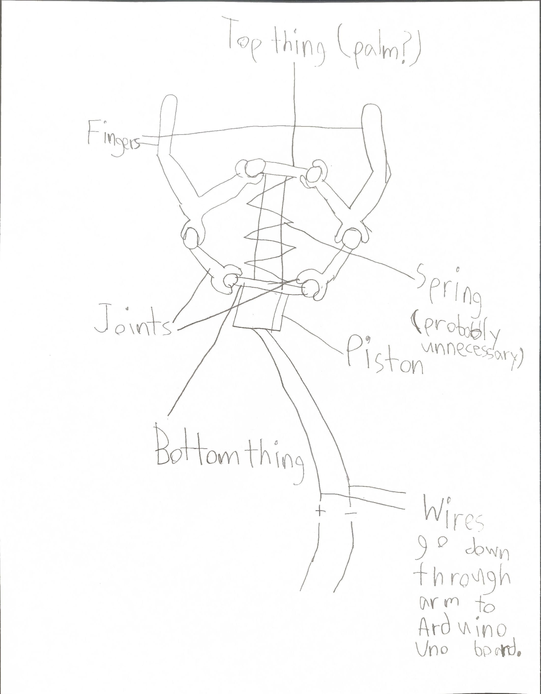

# MechanicalArm
This is a mechanical arm that is joystick controlled and is able to pick stuff up. The arm is jointed and rotates on a base. The claw uses a linear motion actuator connected to an Arduino Uno board
 attached to the base. The claw is also removable.

## Top thing
- [Click here to access design](https://cad.onshape.com/documents/b72a9087ef7fb48dc9188afa/w/35a1132e0a0cda823995eb3e/e/7ec5a70d296b25a5454d7b1f?renderMode=0&uiState=6acd6678b51d45f768344b32)
## Claw Base
- [Click here to access design](https://cad.onshape.com/documents/6ec7c175b33a6572bb242552/w/f52ecc3acbd8abf83b5fc245/e/7eb7323db3b094bd660525e0)

## Claw Design Sketch (drawing is not accurate)

## Work Plan

| Week | What I will do (if project cannot be finnished by end of Term 2 due to time/complexity/whatever else continue on Term 3) |
| --- | --- | 
| 1 | Design top thing (palm?) and have printed (if not possible to have printed by Week 1 print on Week 2) | 
| 2 | Design bottom thing and hav printed if possible (if not possible to have printed by Week 2 print on Week 3) | 
| 3 | Finish arm base and have printed + begin assembly of claw | 
| 4 | Continue assembly of claw if not finished + begin designing parts of arm if possible | 
| 5 | Print arm parts + finish claw assembly if not already done | 
| 6 | Assemble printed arm parts (if all are finished printing) | 
| 7 | Assemble base + printed arm parts if not finished assembling | 
| 8 | Finish assembly of the whole project | 

